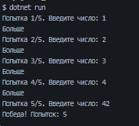
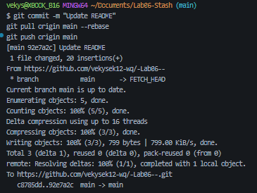

# Практическая работа №6 
**ФИО: Сташенко Дмитрий Николаевич**   
**Группа: ИСП-243**   
**Дата: 17.10.2026** 
## Что изучено
Конструкции:
- for
- while
- do while
- break
- continue.

#### Чем while отличается от do while.
 Цикл while сначала проверяет условие и только потом выполняет тело — если условие изначально ложно, тело не выполнится ни разу. Цикл do while наоборот: сначала один раз выполняет тело, а потом проверяет условие, поэтому тело гарантированно выполнится хотя бы один раз.
 

 
— работающая программа «Угадай число»

 — терминал после git push.